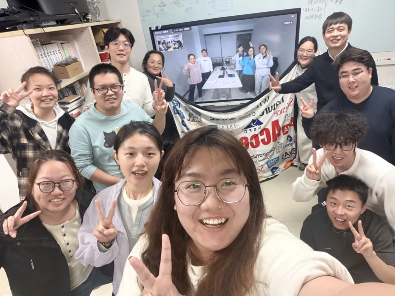

# Ren Protein Design Group

We study how proteins move, how they recognize their binding partners, and how changes in sequence affect their function. Led by Zilin Ren, our group combines molecular dynamics simulations, structure prediction, and machine learning to study and design enzymes and interacting proteins.

[Group website](https://rpdgroup.github.io/) · [Research](https://rpdgroup.github.io/#research) · [Publications](https://rpdgroup.github.io/#publications) · [Contact](https://rpdgroup.github.io/#contact)

## Research questions

- **Which motions matter for protein function?** A structure captures one conformation. We use molecular dynamics trajectories to examine the range of conformations a protein samples, which regions move together, and how that flexibility relates to binding and catalysis. We also develop generative models to sample ensembles for proteins with one or more chains.
- **What makes a protein interface a plausible binding arrangement?** Different docking poses can bring the same two proteins into contact. We study the shape and chemistry of the contacting surfaces to evaluate candidate complexes, with a particular interest in enzyme interactions and antibody recognition.
- **What can we learn from sequence changes?** An amino acid substitution can alter protein stability. A synonymous codon change preserves the amino acid but changes the coding sequence. These questions call for different models, from predictors of mutation effects to models that learn codon preferences.

## Models, data, and tools

| If you want to… | Start here |
| --- | --- |
| Sample alternative conformations of a protein or complex | [DynoM](https://github.com/RPDGroup/DynoM) uses conditional diffusion to generate conformational ensembles and supports multi-chain inputs. |
| Analyze simulated small-protein ensembles | [DynoDB](https://github.com/RPDGroup/DynoDB) includes 100 ns all-atom simulations for 8,385 small proteins. The repository contains GROMACS workflows and notebooks for trajectory analysis, annotation, and reproducibility checks. [Download the dataset](https://huggingface.co/datasets/RPDGroup/DynoDB). |
| Browse simulation results for protein complexes | The [DynoDB web database](https://ai4scenter-dynodb.nenu.edu.cn/) provides trajectories and analysis results for complexes. |
| Compare candidate antibody binding poses | [ABUS](https://github.com/RPDGroup/ABUS) scores antigen–antibody interfaces using geometric and physicochemical features. The repository includes example structures and tools for preprocessing, inference, and training. |
| Model synonymous codon choices | [CodonBERT](https://github.com/RPDGroup/CodonBERT) uses a BERT-based cross-attention model for codon optimization. The repository provides the implementation and training instructions. |

## Selected publications

- **Protein dynamics** · Hu, Yang and colleagues describe how the DynoDB small-protein ensembles were generated, analyzed, and validated. [Data descriptor in *Scientific Data* (2026)](https://doi.org/10.1038/s41597-026-07759-2)
- **Protein stability** · MuFaDDG predicts mutation-induced changes in protein stability by combining sequence features at multiple scales. [Method and evaluation in *Bioinformatics* (2026)](https://doi.org/10.1093/bioinformatics/btag196)
- **Sequence modeling** · The CodonBERT paper describes the cross-attention architecture and evaluates its codon optimization performance. [Article in *Bioinformatics* (2024)](https://doi.org/10.1093/bioinformatics/btae330)

## The group

[Meet our members](https://rpdgroup.github.io/#members) · [Group activities](https://rpdgroup.github.io/#activities) · [All repositories](https://github.com/orgs/RPDGroup/repositories)
